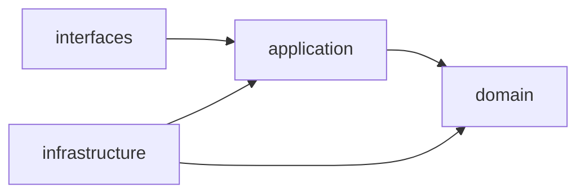

# Arquitectura de ingestion-api

API pública para la ingesta de datos de observabilidad. Valida los datos recibidos y los publica en RabbitMQ para su procesamiento.

El proyecto sigue DDD con arquitectura hexagonal y Clean Architecture, según [la guía de arquitectura de Python](../../../.harness/architecture/python.md).

| Capa | Responsabilidad |
|---|---|
| `domain` | Núcleo del negocio: entidades, puertos y excepciones. Sin dependencias externas. |
| `application` | Casos de uso y DTO. |
| `infrastructure` | Adaptadores de salida: configuración, persistencia y mensajería. |
| `interfaces` | Adaptadores de entrada: API HTTP versionada (`/api/v1`). |
