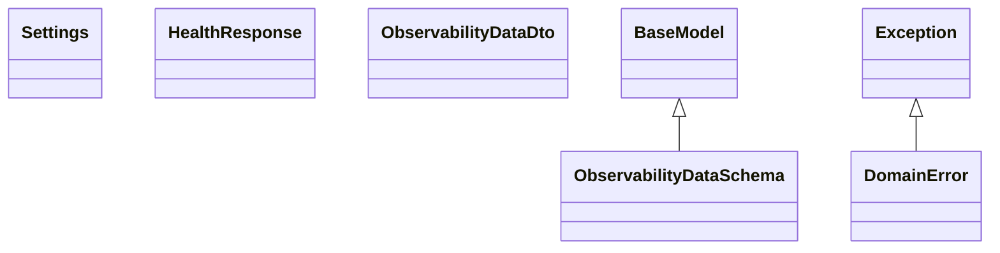

# Clases de ingestion-api

## Diagrama de clases

## Definición de clases

### `Settings` (`infrastructure/config/settings.py`)

Configuración inmutable leída de variables de entorno.

- Propiedades: `rabbitmq_url`.
- `from_env(environ)`: construye la configuración. Lanza `ValueError` si falta una variable obligatoria.

### `DomainError` (`domain/exceptions.py`)

Excepción base del dominio.

### `HealthResponse` (`interfaces/api/schemas/health_response.py`)

Respuesta del endpoint `GET /api/v1/health`, serializada en `camelCase`. Propiedad: `status`.

### `ObservabilityDataDto` (`application/dtos/observability_data_dto.py`)

DTO inmutable con las propiedades base de todo objeto de observabilidad, independiente de HTTP. Los DTO de los tipos concretos heredan de él.

- Obligatorias: `app_name`, `app_version`, `span_id`, `timespan` (con zona horaria) y `trace_id`.
- Opcionales: `client_ip_address`, `client_version`, `extra_data` y `host_name`.
- `MAX_LENGTHS`: longitudes máximas de las propiedades de texto, iguales a las de la especificación `observability-base-data`.
- Lanza `ValueError` si una obligatoria está vacía, si `timespan` no tiene zona horaria o si un texto supera su longitud máxima.

### `ObservabilityDataSchema` (`interfaces/api/schemas/observability_data_schema.py`)

Esquema de entrada y salida de las propiedades base, en `camelCase` (`appName`, `appVersion`, `clientIpAddress`, `clientVersion`, `extraData`, `hostName`, `spanId`, `timespan`, `traceId`). Rechaza `snake_case`, textos vacíos, `timespan` sin zona horaria o fuera de ISO 8601, `extraData` que no sea un diccionario y textos que superen su longitud. Los esquemas de los tipos concretos heredan de él.
