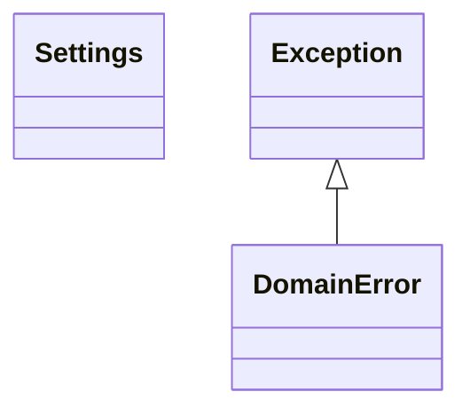

# Clases de ingestion-workers

## Diagrama de clases

## Definición de clases

### `Settings` (`infrastructure/config/settings.py`)

Configuración inmutable leída de variables de entorno.

- Propiedades: `rabbitmq_url`, `database_url`.
- `from_env(environ)`: construye la configuración. Lanza `ValueError` si falta una variable obligatoria.

### `DomainError` (`domain/exceptions.py`)

Excepción base del dominio.
