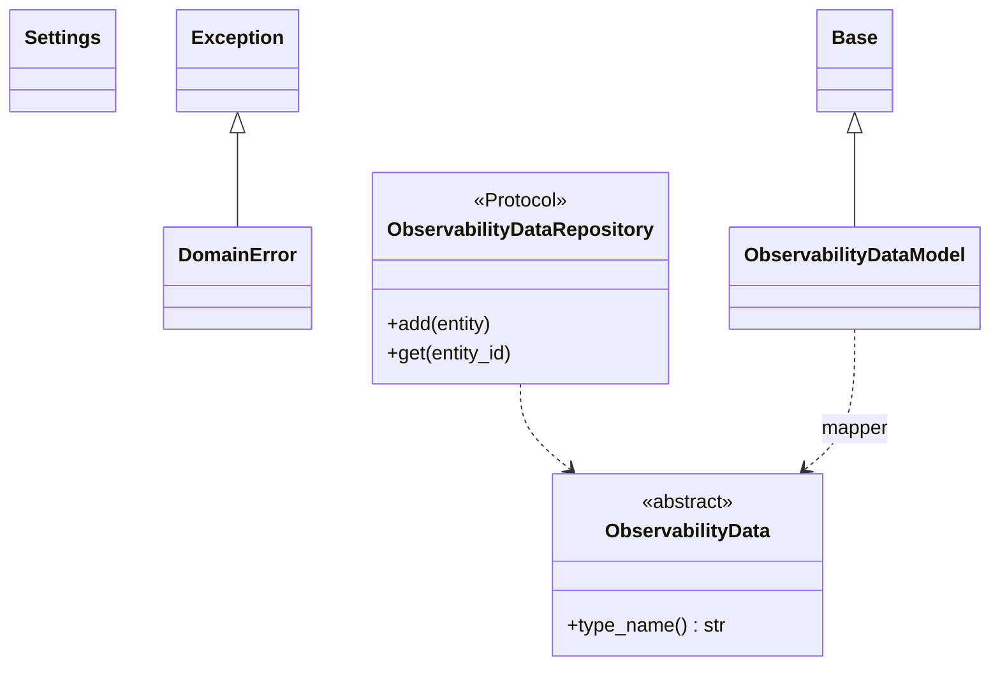

# Clases de ingestion-workers

## Diagrama de clases



## Definición de clases

### `Settings` (`infrastructure/config/settings.py`)

Configuración inmutable leída de variables de entorno.

- Propiedades: `rabbitmq_url`, `database_url`.
- `from_env(environ)`: construye la configuración. Lanza `ValueError` si falta una variable obligatoria.

### `DomainError` (`domain/exceptions.py`)

Excepción base del dominio.

### `ObservabilityData` (`domain/entities/observability_data.py`)

Entidad abstracta con las propiedades base de todo dato de observabilidad. Los tipos concretos heredan de ella.

- Obligatorias: `app_name`, `app_version`, `span_id`, `timespan` (con zona horaria) y `trace_id`.
- Opcionales: `client_ip_address`, `client_version`, `extra_data` y `host_name`.
- `id`: identidad interna (UUID) generada por el sistema.
- Constantes `MAX_*_LENGTH`: longitudes máximas; coinciden con el tamaño de las columnas.
- `type_name()`: método de clase abstracto con el discriminador de persistencia del tipo concreto.
- Lanza `DomainError` si una obligatoria está vacía, si `timespan` no tiene zona horaria o si un texto supera su longitud.

### `ObservabilityDataRepository` (`domain/ports/repositories/observability_data_repository.py`)

Puerto genérico (`Protocol`) con `add(entity)` y `get(entity_id)`. Cada tipo concreto lo especializa con su repositorio de SQLAlchemy.

### `Base` (`infrastructure/persistence/base.py`) y `ObservabilityDataModel` (`infrastructure/persistence/models.py`)

`Base` es la base declarativa de SQLAlchemy. `ObservabilityDataModel` representa la tabla `observability_data` con las propiedades base y la columna discriminadora `type` (herencia unida). `extra_data` es `JSONB` y `timespan` es `TIMESTAMP WITH TIME ZONE`.

### Mappers (`infrastructure/persistence/mappers.py`)

- `observability_data_to_model_fields(entity)`: propiedades base de la entidad con los nombres de columna.
- `observability_data_from_model_fields(model)`: propiedades base de un modelo con los nombres de la entidad.

Los mappers de los tipos concretos los combinan con sus propias propiedades.

## Migraciones

Las migraciones de Alembic viven en `alembic/` (raíz del proyecto, fuera del paquete). La URL se lee de la variable de entorno `DATABASE_URL`.

```bash
uv run alembic upgrade head
uv run alembic downgrade base
```
