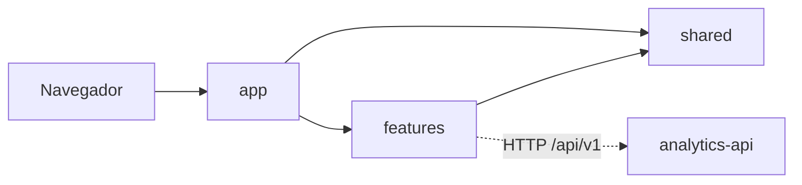

# Arquitectura de analytics-portal

Portal web para visualizar los datos de DeepSight de forma estructurada, con gráficos en tiempo real y filtros. Consume `analytics-api`.

Se organiza por funcionalidad, según [la guía de arquitectura de React](../../../.harness/architecture/react.md).

| Capa                | Responsabilidad                                                                                    |
| ------------------- | -------------------------------------------------------------------------------------------------- |
| `app`               | Arranque, proveedores globales y rutas.                                                            |
| `features/<nombre>` | Funcionalidades autocontenidas (`api`, `components`, `hooks`, `model`, `pages`). Hoy: `dashboard`. |
| `shared`            | Código reutilizable sin conocimiento de negocio.                                                   |
