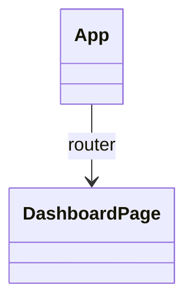

# Componentes de analytics-portal

## Diagrama

## Definición

- `App` (`src/app/App.tsx`): componente raíz; monta el `RouterProvider` con `router`.
- `router` (`src/app/router.tsx`): rutas de la aplicación. La ruta `/` apunta a `DashboardPage`.
- `DashboardPage` (`src/features/dashboard/pages/DashboardPage.tsx`): página de inicio del portal. Sin props.
